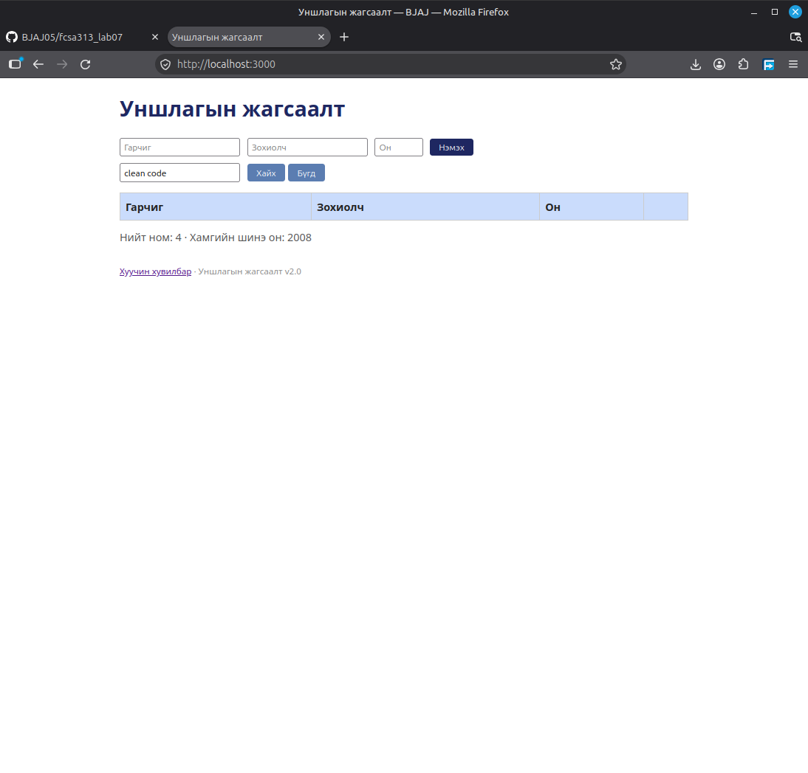

## BUG-02: Ном хайхад жижиг том үсгээс шалтгаалан илэрц олдохгүй байна

Орчин:
- Уншлагын жагсаалт v2.0
- Browser: Firefox
- OS: Linux Mint Cinnamon
- Огноо: 2026-10-20

Урьдчилсан нөхцөл:
- `node app.js` шинээр асаасан (анхны 3 ном)

## Дахин гаргах алхам
1. Browser-оор вебэд хандана
2. "Хайх үг" талбарт `clean code` гэж бичнэ
3. "Хайх" товч дарна

Хүлээгдэж байсан: "Clean Code" нэртэй ном хайлтын үр дүнгээр гарч ирнэ.

Бодит үр дүн: Ном олдоогүй

Ноцтой байдал: Critical. Хэрэглэгч хайсан номоо олж чадахгүй байна.

Хавсралт: 

Олдсон аялал: Fed-Ex аялал
