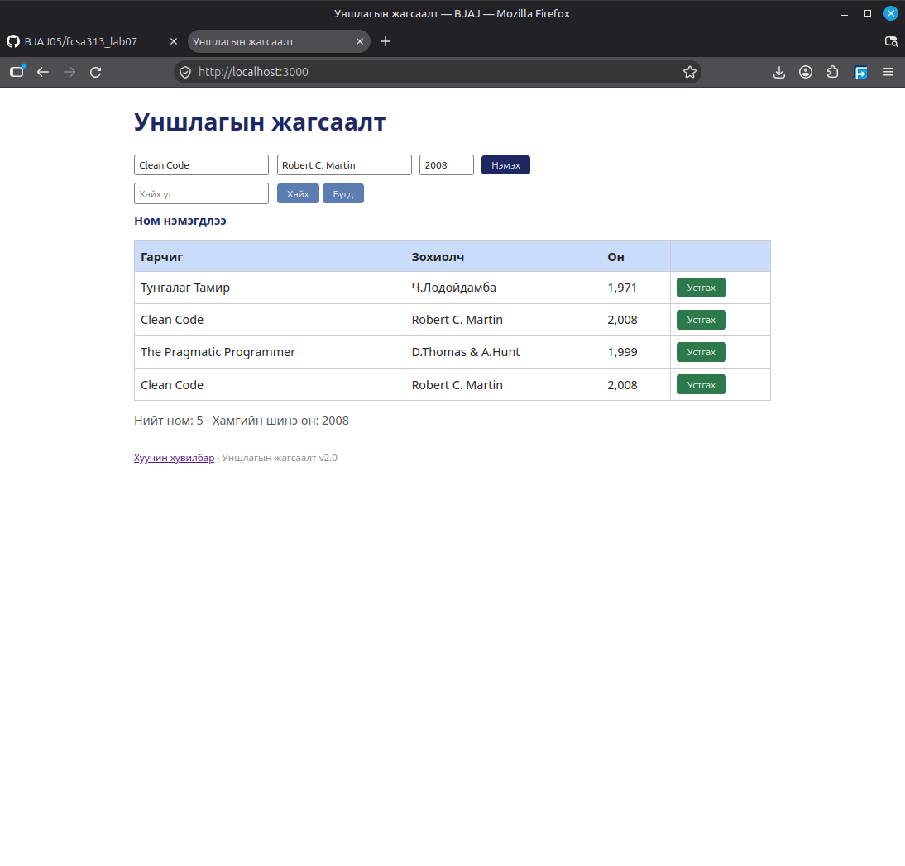

## BUG-03: Ижил гарчиг, зохиогчтой номыг хадгалж байна

Орчин:
- Уншлагын жагсаалт v2.0
- Browser: Firefox
- OS: Linux Mint Cinnamon
- Огноо: 2026-10-20

Урьдчилсан нөхцөл:
- `node app.js` шинээр асаасан (анхны 3 ном)

## Дахин гаргах алхам
1. Browser-оор вебэд хандана
2. Ном нэмэх талбаруудыг аль нэг номтой адил байхаар бөглөнө.

Хүлээгдэж байсан: Тухайн ном давхцах тул нэмэх боломжгүй

Бодит үр дүн: Номын давхардан үүссэн

Ноцтой байдал: Major. Хэрэглэгч санамсаргүйгээр нэг номыг олон удаа нэмэх боломжтой байна.

Хавсралт: 

Олдсон аялал: Fed-Ex аялал
