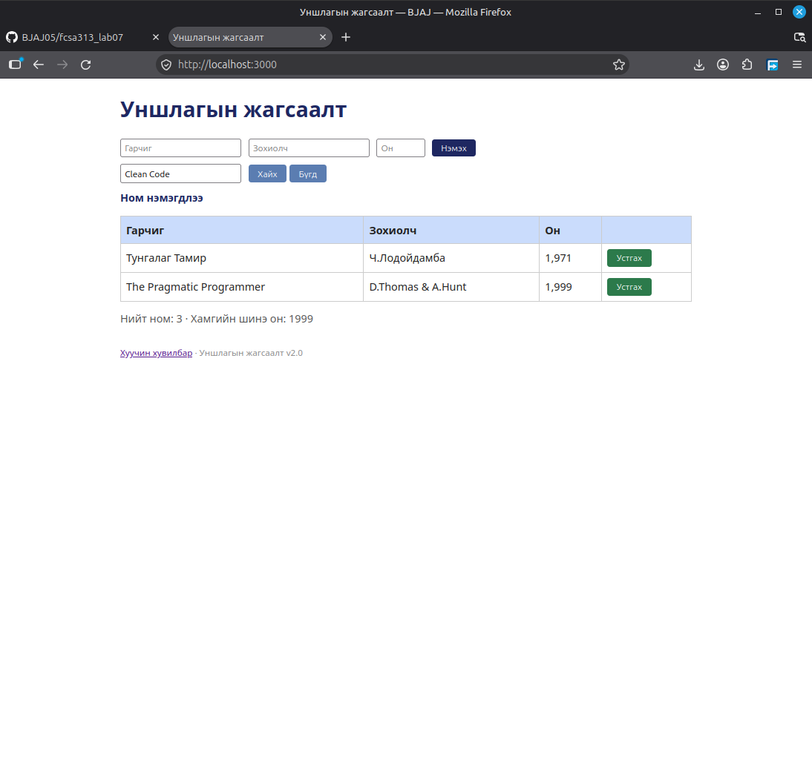

## BUG-04: Ном нэмэх, устгах үйлдлийн дараа хайлтын үр дүн бүх номыг харуулсан

Орчин:
- Уншлагын жагсаалт v2.0
- Browser: Firefox
- OS: Linux Mint Cinnamon
- Огноо: 2026-10-20

Урьдчилсан нөхцөл:
- `node app.js` шинээр асаасан (анхны 3 ном)

## Дахин гаргах алхам
1. Browser-оор вебэд хандана
2. "Хайх үг" талбарт `Clean Code` гэж бичиж, хайна
3. Ном нэмэх эсвэл устгана.

Хүлээгдэж байсан: "Clean Code" хайлтын үр дүн зөв харагдана.

Бодит үр дүн: Үйлдийн дараа үлдсэн бүх номыг харуулсан

Ноцтой байдал: Minor. Хэрэглэгч дахин хайх товч дарж, хайлтын үр дүнгээ харна.

Хавсралт: 

Олдсон аялал: Fed-Ex аялал
