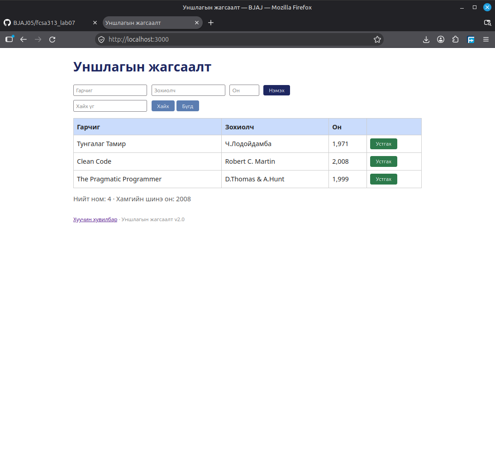

## BUG-05: Устгах товчын өнгө улаан биш байна

Орчин:
- Уншлагын жагсаалт v2.0
- Browser: Firefox
- OS: Linux Mint Cinnamon
- Огноо: 2026-10-20

Урьдчилсан нөхцөл:
- `node app.js` шинээр асаасан (анхны 3 ном)

## Дахин гаргах алхам
1. Browser-оор вебэд хандана

Хүлээгдэж байсан: Устгах товчын өнгө улаан байх

Бодит үр дүн: Устгах товчын өнгө ногоон байсан

Ноцтой байдал: Critical. Хэрэглэгч товч андууран устгах үйлдэл хийх аюултай.

Хавсралт: 

Олдсон аялал: Supermodel аялал
