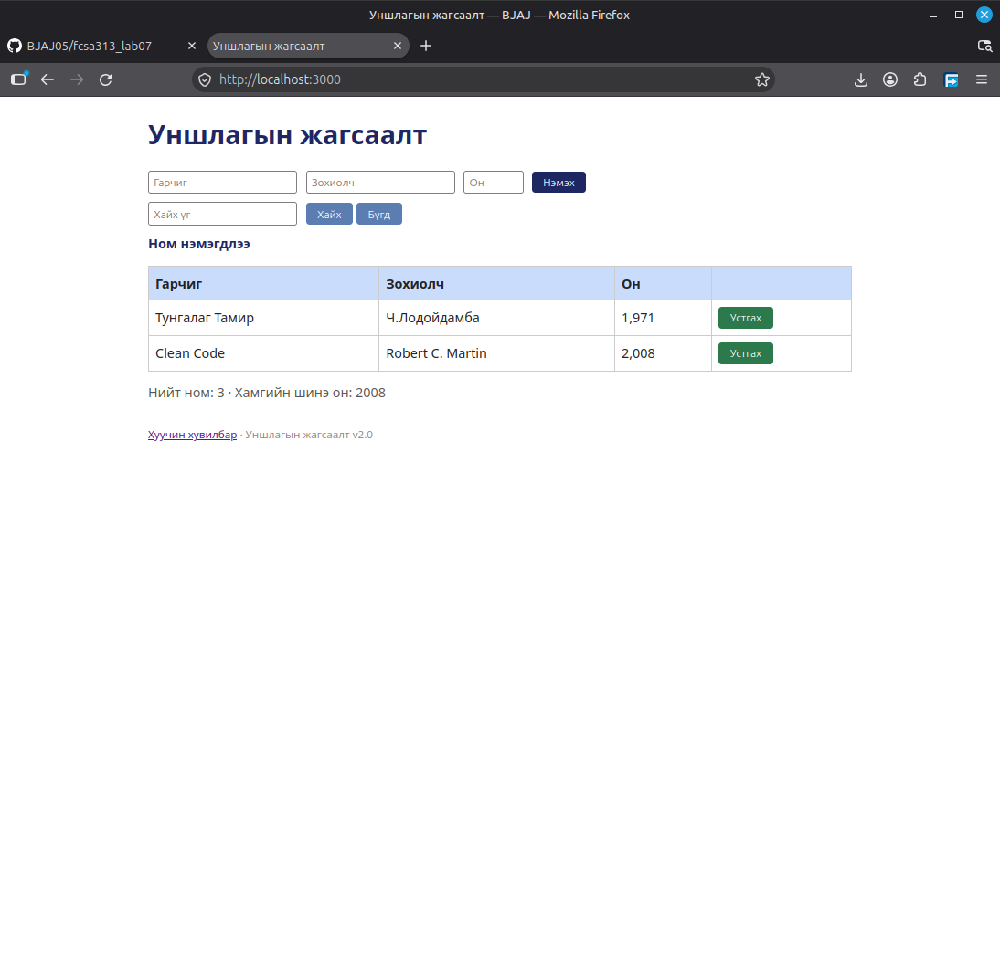

## BUG-06: Ном устгахад "Ном нэмэгдлээ" текст гарч ирсэн

Орчин:
- Уншлагын жагсаалт v2.0
- Browser: Firefox
- OS: Linux Mint Cinnamon
- Огноо: 2026-10-20

Урьдчилсан нөхцөл:
- `node app.js` шинээр асаасан (анхны 3 ном)

## Дахин гаргах алхам
1. Browser-оор вебэд хандана
2. Нэг ном устгана

Хүлээгдэж байсан: Хүснэгтийн дээр "Ном устгагдлаа" текст гарч ирэх

Бодит үр дүн: Хүснэгтийн дээр "Ном нэмэгдлээ" текст гарч ирсэн

Ноцтой байдал: Minor. Хэрэглэгч зөв товч дарсан эсэхээ мэдэхгүй, эргэлзэхээр байна.

Хавсралт: 

Олдсон аялал: Supermodel аялал
