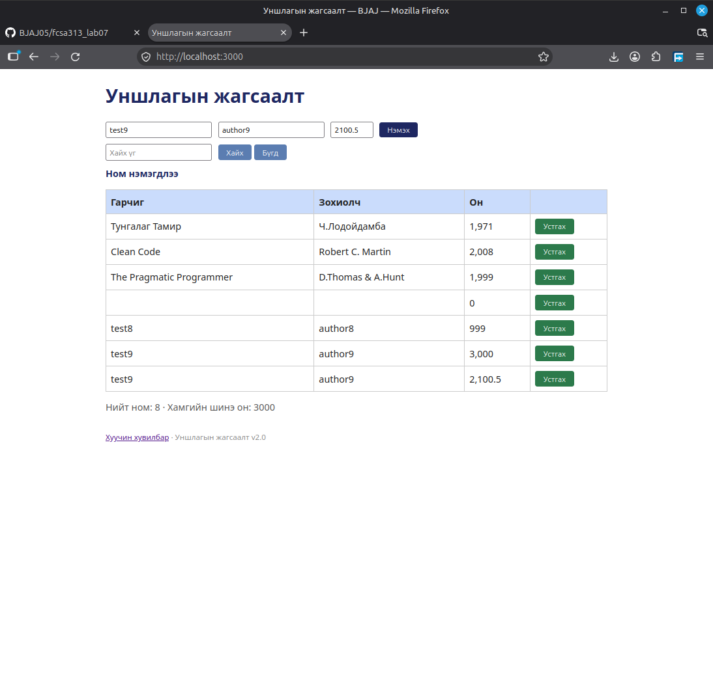

## BUG-08: Номын оныг хязгаараас гадна болон бутархай оруулах боломжтой байна

Орчин:
- Уншлагын жагсаалт v2.0
- Browser: Firefox
- OS: Linux Mint Cinnamon
- Огноо: 2026-10-20

Урьдчилсан нөхцөл:
- `node app.js` шинээр асаасан (анхны 3 ном)

## Дахин гаргах алхам
1. Browser-оор вебэд хандана
2. Гарчиг, зохиолч талбарыг бөглөнө
3. Он талбарыг хязгаараас гадна болон бутархай тоо оруулна
4. Ном нэмэх товч дарна

Хүлээгдэж байсан: Ном нэмэгдэхгүй байх, алдааны мессеж харуулах

Бодит үр дүн: Ном үүссэн.

Ноцтой байдал: Critical. Системийн үндсэн тодорхойлолтоос зөрсөн, он нь 1000-2100 хооронд биш байна.

Хавсралт: 

Олдсон аялал: Couch Potato аялал
